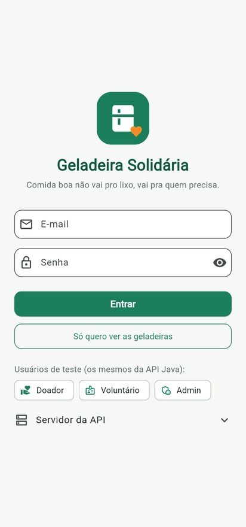
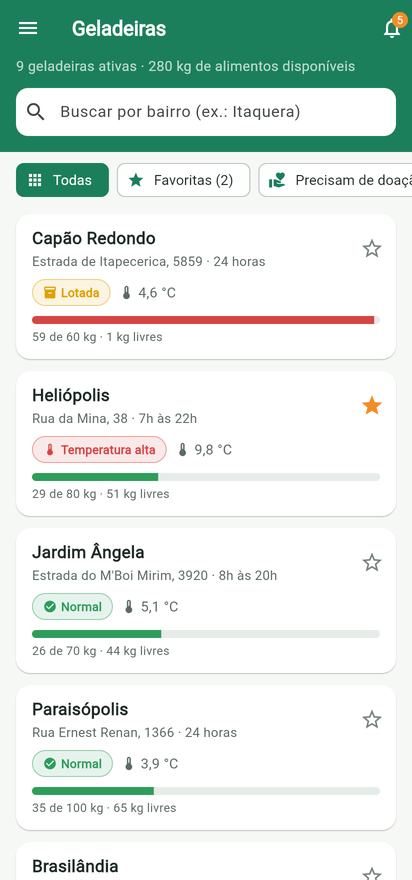
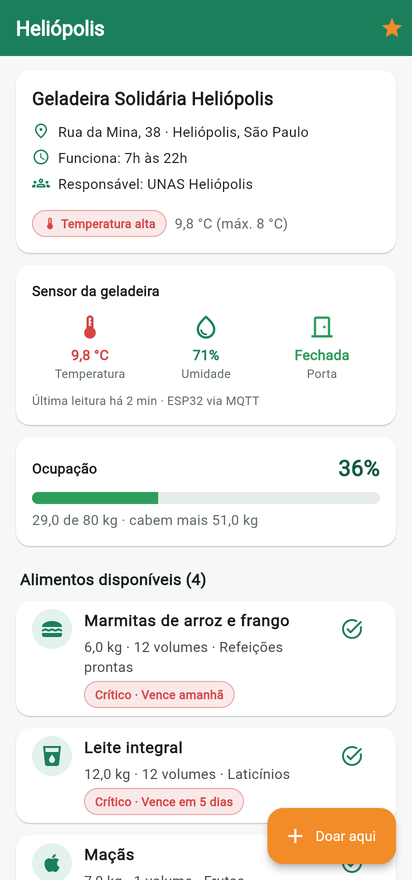
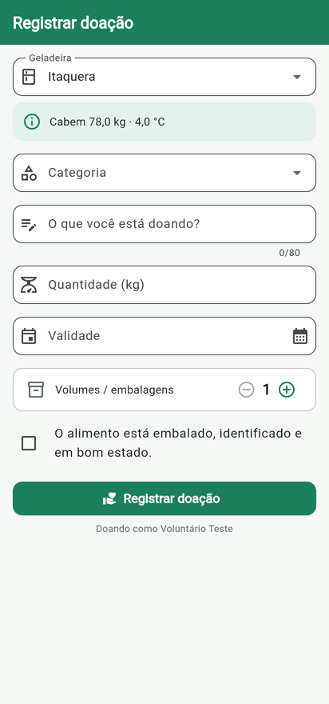
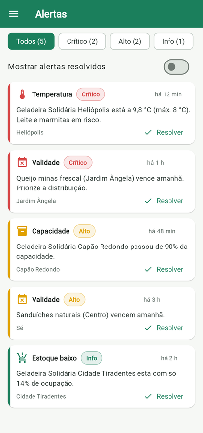
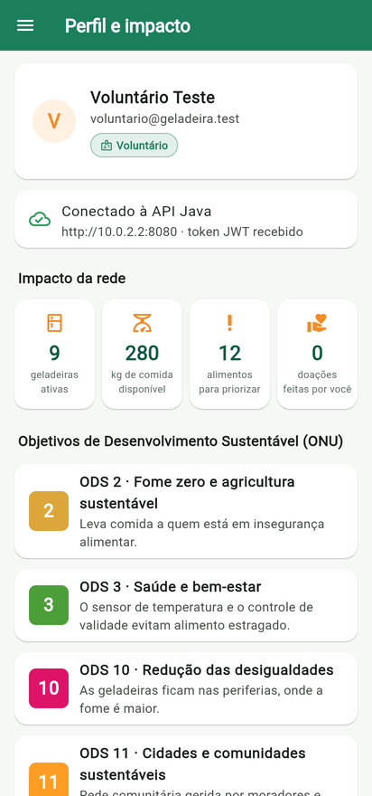
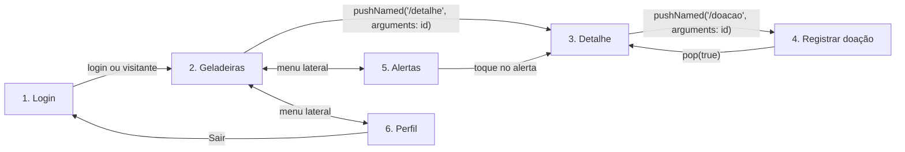

# Geladeira Solidária: app mobile (Flutter)

**Global Solution 2026/2 · CitizenTech · FIAP, 2º ano de ADS**
**Disciplina:** Mobile Application Development

| Integrante | RM | Turma |
|---|---|---|
| Ruan Ribeiro | 567693 | 2TDSPA |

**Grupo:** Geladeira Solidária Inteligente
**Vídeo de demonstração (emulador):** https://youtu.be/wZetgJfhDLk
**App publicado (APK):** https://github.com/Ruan-Ribeiro00/geladeira-solidaria-app/releases

---

## 1. O problema e a solução

Geladeiras solidárias são geladeiras instaladas em espaços públicos onde comércios e moradores deixam alimentos e qualquer pessoa retira o que precisa. Hoje ninguém sabe, de longe, se a refrigeração falhou, o que está vencendo ou quais geladeiras estão lotadas enquanto outras, a poucos bairros dali, estão vazias.

Este app é a ponta da solução que as pessoas usam no celular:

- **qualquer pessoa** vê as geladeiras da rede, onde ficam, o que tem dentro e se estão funcionando;
- **doadores** registram o que deixaram, e o app recusa doação que não cabe, que já venceu ou que precisa de geladeira fria numa geladeira quente, **sugerindo outra geladeira**;
- **voluntários** acompanham os **alertas** (temperatura, validade, lotação, estoque baixo) e marcam alimentos retirados.

As leituras de temperatura, umidade e porta vêm do sensor IoT (ESP32 → MQTT → API Java). O login usa a mesma **API Java** da disciplina de Java Advanced.

## 2. ODS atendidos

| ODS | Como o app contribui |
|---|---|
| **2 · Fome zero** | Mostra onde tem comida disponível e leva doações para as geladeiras que precisam. |
| **3 · Saúde e bem-estar** | Temperatura e validade de cada alimento evitam que alguém coma comida estragada. |
| **10 · Redução das desigualdades** | As geladeiras ficam nas periferias de São Paulo, onde a fome é maior. |
| **11 · Cidades e comunidades sustentáveis** | Rede comunitária gerida por moradores, comércios e voluntários. |
| **12 · Consumo e produção responsáveis** | Comida que iria para o lixo vira doação. |

## 3. Telas

| Login | Geladeiras | Detalhe |
|:-:|:-:|:-:|
|  |  |  |
| **Registrar doação** | **Alertas** | **Perfil e impacto** |
|  |  |  |

| # | Tela | Rota | O que faz |
|---|---|---|---|
| 1 | Login | `/` | Formulário validado. Faz `POST /auth/login` na API Java e guarda o token JWT. Também dá para entrar como visitante. |
| 2 | Geladeiras | `/geladeiras` | Lista com busca por bairro, filtros (favoritas, precisam de doação, com espaço), situação, temperatura e ocupação de cada uma. Favoritar com a estrela. |
| 3 | Detalhe da geladeira | `/detalhe` | **Recebe o id da geladeira como parâmetro da rota.** Endereço, sensor, ocupação e alimentos disponíveis com o risco de cada um. Voluntário marca como retirado. |
| 4 | Registrar doação | `/doacao` | **Recebe o id da geladeira como parâmetro.** Formulário com validação, data de validade, contador de volumes e as regras de doação. |
| 5 | Alertas | `/alertas` | Só para voluntário e admin. Filtro por nível, mostrar resolvidos e botão de resolver (com desfazer). |
| 6 | Perfil e impacto | `/perfil` | Usuário logado, se está conectado à API, números da rede e os ODS. |

### Navegação



## 4. Requisitos da disciplina

| Requisito | Onde está |
|---|---|
| 5 ou mais telas | 6 telas, uma por arquivo em `lib/screens/`, registradas em `routes` no `main.dart` |
| Navegação com rotas nomeadas e **passagem de parâmetro** | `Navigator.pushNamed(context, '/detalhe', arguments: g.id)` em `geladeiras_screen.dart`; leitura com `ModalRoute.of(context)!.settings.arguments` em `detalhe_geladeira_screen.dart` e `nova_doacao_screen.dart`. A tela de doação devolve um resultado com `Navigator.pop(context, true)`. |
| `StatefulWidget` + `setState` | Favoritar geladeira (lista e detalhe), busca e filtros, contador de volumes (− / +), mostrar senha, checkbox, resolver alerta, marcar retirada, troca de geladeira pela sugestão |
| Formulário com `GlobalKey<FormState>` | Login (`_formKey` com e-mail e senha) e Registrar doação (`_formKey` com 5 campos), com `validator` em cada campo e `validate()` antes de enviar |
| SnackBar | Resultado do login, doação registrada ou recusada (com ação "Usar outra geladeira"), favoritar, resolver alerta e marcar retirada (com ação "Desfazer") |
| Widgets vistos em aula | `MaterialApp`, `Scaffold`, `AppBar`, `Drawer`, `ListView.builder`, `Card`, `ListTile`, `Column`/`Row`, `TextFormField`, `DropdownButtonFormField`, `ElevatedButton`, `IconButton`, `FloatingActionButton`, `ChoiceChip`, `SwitchListTile`, `CheckboxListTile`, `LinearProgressIndicator`, `showDatePicker`, `Badge` |
| Identidade visual consistente | `lib/tema.dart`: paleta (verde + laranja), `ThemeData` único para botões, campos, cards e AppBar, logo e ícone próprio do app (`docs/icone.png`, aplicado em `android/app/src/main/res/mipmap-*`) |
| Coerência com a solução da GS | Mesmos dados, regras e usuários da API Java; leituras do sensor IoT na tela de detalhe |
| README com ODS e declaração de IA | Este arquivo (seções 2 e 10) |

Gerência de estado: só `setState`. Os dados ficam num objeto único em memória (`Repositorio.instancia`), e cada tela chama `setState` depois de alterar alguma coisa ou ao voltar de outra tela.

## 5. Como rodar

**Pré-requisitos:** Flutter 3.32 ou mais recente e Android Studio com um emulador Android criado (Device Manager → Create device). Confira com `flutter doctor`.

```bash
git clone <url-deste-repositorio>
cd geladeira-solidaria-app
flutter pub get
flutter run          # com o emulador aberto
```

### Com a API Java (login de verdade)

1. Suba a API Java (repositório da disciplina de Java Advanced) no seu PC: `docker compose up -d` e `.\mvnw.cmd spring-boot:run`.
2. No app, o endereço padrão já é `http://10.0.2.2:8080`. Dentro do emulador Android, `10.0.2.2` é o `localhost` do seu PC.
3. Se a API estiver na VM do Azure (disciplina de DevOps), abra **Servidor da API** na tela de login e troque para `http://IP-DA-VM:8080`.

Se a API não responder, o app entra em **modo offline** com os mesmos usuários de teste. A tela de Perfil mostra se você está conectado à API ou offline.

### Usuários de teste

Os mesmos da API Java (na tela de login, os botões **Doador**, **Voluntário** e **Admin** preenchem o e-mail e a senha):

| Papel | E-mail | Senha | O que vê no app |
|---|---|---|---|
| DOADOR | `doador@geladeira.test` | `Doador@123` | Geladeiras, detalhe, registrar doação, perfil |
| VOLUNTARIO | `voluntario@geladeira.test` | `Voluntario@123` | Tudo do doador + alertas + marcar alimento retirado |
| ADMIN | `admin@geladeira.test` | `Admin@123` | O mesmo do voluntário |
| Visitante | (sem login) | | Só vê as geladeiras |

### Gerar o APK

```bash
flutter build apk --release
```

O arquivo sai em `build/app/outputs/flutter-apk/app-release.apk` e é publicado na aba **Releases** do GitHub.

## 6. Regras de negócio no app

São as mesmas da API Java, com os mesmos limites (8 °C, 90%, 20%, 60 min), em `lib/data/repositorio.dart`:

| Regra | Como funciona |
|---|---|
| **Situação da geladeira** | Em ordem: em manutenção → sensor sem leitura há mais de 60 min → acima de 8 °C → 90% ou mais ocupada (lotada) → 20% ou menos (precisa de doações) → normal. Temperatura vem antes de lotação porque é risco à saúde. |
| **Risco do alimento** | Vencido → VENCIDO; refrigerado numa geladeira acima da temperatura da categoria → CRÍTICO; vence hoje ou amanhã → CRÍTICO; vence em 2 ou 3 dias → ATENÇÃO; senão, OK. A lista do detalhe mostra primeiro o que vence primeiro. |
| **Registro de doação** | Quantidade maior que zero, alimento não vencido, geladeira ativa, refrigerado só em geladeira fria o bastante e a doação tem que caber. Se for recusada, o SnackBar sugere a geladeira ativa com mais espaço livre. Passou de 90%, abre um alerta de capacidade. |

Para ver as regras na prática: tente doar 5 kg na geladeira do **Capão Redondo** (só tem 1 kg livre) ou um laticínio na de **Heliópolis** (está a 9,8 °C).

## 7. Estrutura

```
lib/
├── main.dart                      MaterialApp, tema e rotas nomeadas
├── tema.dart                      cores, ThemeData e logo (identidade visual)
├── models/modelos.dart            Geladeira, Categoria, Doacao, Alerta, Usuario e enums
├── data/repositorio.dart          dados de exemplo e regras de negócio
├── services/auth_service.dart     login na API Java (pacote http)
├── widgets/componentes.dart       etiqueta, barra de ocupação, menu lateral
└── screens/                       as 6 telas
test/
├── regras_test.dart               testes das regras de negócio
└── app_test.dart                  testes de interface (login, lista, detalhe, doação, alertas, perfil)
```

## 8. Testes

```bash
flutter test
```

São 19 testes: 9 das regras de negócio e 10 de interface, que navegam pelo app como um usuário (login com a API falsa online e fora do ar, busca e favoritas, parâmetro da rota, formulário de doação válido e recusado, resolver alerta, menu lateral).

## 9. Dados

Os dados são de exemplo (permitido pela disciplina) e espelham a carga inicial da API Java: 10 geladeiras em bairros de São Paulo, 10 categorias, 35 doações e 6 alertas. As datas são relativas a hoje, então o cenário é o mesmo em qualquer dia. Nomes, endereços e responsáveis são fictícios ou usados só como exemplo.

## 10. Uso de IA generativa

Este app foi desenvolvido com apoio do Claude (Anthropic), que gerou a estrutura inicial das telas, os dados de exemplo, os testes e este README a partir dos requisitos da disciplina e da API Java do projeto. Todo o código foi revisado, executado no emulador e testado pelo integrante, que é responsável pelo conteúdo entregue.
